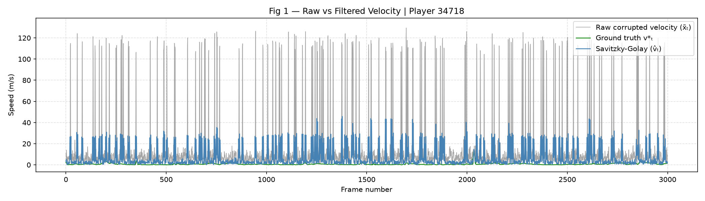
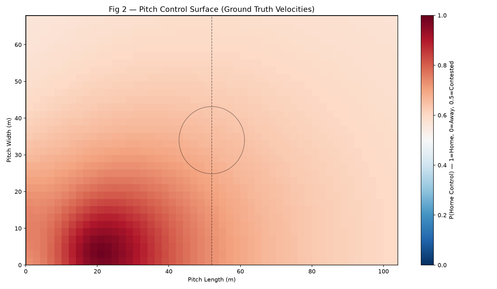
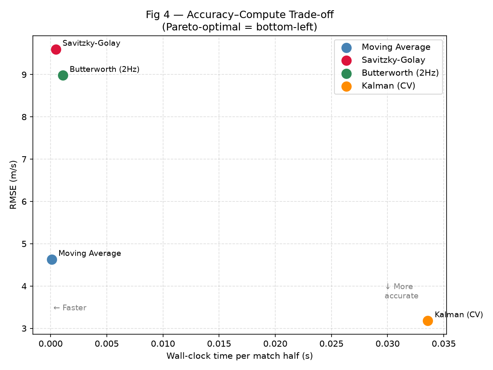

# Spearman Pitch Control: From Tracking Noise to Pitch-Map Distortion

This project is a compact research pipeline for one football match, with a second cross-match runner for broader comparison. The code takes raw player tracking, reconstructs velocity, injects synthetic noise, applies multiple filters, and then measures how much each filter changes the downstream pitch-control surface.

The core question is not just "which filter makes the smoothest line?" It is "which filter preserves the football decision model best?" That is the right framing, because the paper is about a chain of effects: noisy position -> filtered velocity -> pitch-control weights -> quantitative distortion.

## The Story In One Sentence

The code tests whether classical smoothing filters can recover player speed from noisy tracking data without damaging a pitch-control model that depends on those velocities.

## End-to-End Pipeline

1. Load one match from `data/archive_skillcorner/<match_id>/`.
2. Read player-team mapping, player tracking, and active evaluation frames.
3. Reconstruct a clean velocity baseline using Savitzky-Golay smoothing.
4. Inject synthetic Gaussian noise plus occasional spikes so the filters have a controlled recovery task.
5. Run four filters on every player track: moving average, Savitzky-Golay, Butterworth, and Kalman.
6. Compare each filter against the reconstructed ground truth using RMSE.
7. Convert filtered velocities into pitch-control surfaces and measure MAE distortion against the ground-truth surface.
8. Rank the filters by accuracy, compute cost, and downstream model distortion.

The single-match entrypoint is [Spearman_Pitch_Control/main.py](Spearman_Pitch_Control/main.py). The cross-match runner is [Spearman_Pitch_Control/rough.py](Spearman_Pitch_Control/rough.py).

## What Each Module Does

`config.py` defines the match paths, pitch geometry, filter parameters, and pitch-control constants. The current structure is deliberately simple because the project is paper-oriented rather than framework-oriented.

`loader.py` reads the JSON and CSV inputs and picks evaluation frames from the active phase of play. It now validates the active-frame selection more defensively instead of assuming the CSV will always be perfect.

`filters.py` is the signal-processing core. It builds the synthetic ground truth, injects noise, and returns velocity estimates from each filter.

`pitch_control.py` turns player positions and velocities into a pitch-control surface on a fixed grid, then computes surface-level error.

`visualiser.py` saves the paper figures to `outputs/`.

## Main Findings

On the validated match (`1899585`), the results are consistent and the ranking is clear:

| Filter            | Velocity RMSE | Pitch-control MAEmap |                    Timing |
| ----------------- | ------------: | -------------------: | ------------------------: |
| Moving Average    |        4.6322 |               0.0107 |                 very fast |
| Savitzky-Golay    |        9.6011 |               0.0237 |                      fast |
| Butterworth (2Hz) |        8.9833 |               0.0221 |                      fast |
| Kalman (CV)       |        3.2174 |               0.0061 | slower, but best accuracy |

The important interpretation is:

- Kalman gives the best velocity recovery and the lowest pitch-control distortion.
- Moving average is computationally cheap, but it leaves more recovery error than Kalman.
- Savitzky-Golay and Butterworth smooth the signal, but they do not preserve the model as well as Kalman in this setup.
- The pitch-control sensitivity to beta is monotonic and stable in this match, which is a useful sign that the model is behaving consistently.

That is the paper’s core conclusion: a filter can look good on a smoothed trace and still be worse for the downstream football model. The downstream metric is the more important one.

## Visual Evidence

The code writes the paper figures into `outputs/`.

What these figures are showing:

- Figure 1 shows the trajectory of raw noisy speed, filtered speed, and ground truth for one representative player.
- Figure 2 shows the control surface implied by ground-truth velocities.
- Figure 3 shows how much the best and worst filters diverge in pitch-control space.
- Figure 4 shows the trade-off between accuracy and compute cost.

## Problems Found In The Code

The project was runnable, but there were several real structural problems. The ones that mattered most were:

- The cross-match runner was initially using stale config state, so it looked like it was processing 10 matches while actually reusing the same loaded data. That made the cross-match statistics misleading.
- The ranking summary in `rough.py` crashed when a filter was missing from one match’s results.
- The filter pipeline only checked against the short smoothing window, not the longer ground-truth smoothing window.
- The main script could crash with `StopIteration` if no player had valid filter output.
- The loader assumed the active-phase CSV would always contain enough candidate frames.
- The repo contained parallel implementations of similar utilities across `pitch_control.py`, `matrices.py`, and `error_calculation/`, which invites drift.
- `rough.py` was acting like a second pipeline entrypoint rather than a thin orchestrator, which made it easy for its config wiring to diverge from `main.py`.

## What Was Tightened During The Cleanup

The code now behaves more safely without changing the research logic:

- Multi-match runs now follow the current match ID and refresh the home/away team IDs.
- Active-frame selection raises a clear error if the evaluation CSV has no usable rows.
- Short tracks fail early with a readable validation error.
- The main pipeline now checks for the existence of at least one valid player track before timing filters.
- The cross-match ranking table no longer crashes on missing filter metrics.

## What The Research Is Really Measuring

This is not a pure signal-processing benchmark. It is a downstream sensitivity study.

The real metric of interest is: if the velocity estimate changes, how much does the pitch-control surface move?

That makes the paper stronger, because it connects filtering quality to the football decision problem instead of stopping at velocity reconstruction.

## How To Read The Results In Paper Language

If you are writing the paper, the safe interpretation is:

- Kalman is the best overall choice for this dataset because it balances velocity recovery and downstream pitch-control fidelity.
- The simple moving average is attractive when compute is the main constraint, but it is not the best fidelity choice.
- Heavy smoothing does not automatically help the downstream model.
- The ranking is consistent across the available cross-match data, but that cross-match set is currently limited because only two matches have the extracted tracking file present.

## Limitation Worth Stating In The Paper

The cross-match runner only processed two matches successfully because the other match folders were missing `extracted_player_tracking.json`. That means the broader-match claim should be written carefully unless those files are restored.

## Short Takeaway

The code’s purpose is to prove that tracking-noise handling matters all the way down to pitch control. The strongest result in the current data is that Kalman is the best end-to-end option, not because it is the smoothest-looking line, but because it preserves the football model better than the alternatives.
